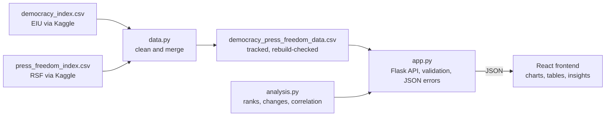

# Global Press Freedom & Democracy Tracker

An interactive dashboard of democracy and press freedom scores for 167 countries from 2013 to 2023.

**[Live site](https://press-freedom-democracy-tracker.vercel.app)** · **[Source code](https://github.com/4shwotts/PressFreedom-Democracy-Tracker)**

[](https://github.com/4shwotts/PressFreedom-Democracy-Tracker/actions/workflows/ci.yml)


---

## What it is

The dashboard puts two published indices side by side: the Economist Intelligence Unit's Democracy Index
(0–10) and Reporters Without Borders' World Press Freedom Index (0–100). It covers 1,818 country-year
observations and describes the published scores without adding its own judgements about countries.

It started as my university dissertation project and was rebuilt as a full-stack web app: a Flask API that
cleans, merges and analyses the data with pandas, and a React frontend that visualises it. The rebuild
was then brought up to a portfolio standard for QA and software engineering, with an emphasis on testing
that the data and the numbers derived from it are correct.

## Features

- **Global map** — a choropleth of either index for any year, with a labelled colour key, zoom and pan,
  tap-to-inspect on touch screens, and an explanation for every grey (no-data) country.
- **Country trends** — both scores over time for one country, an optional second country to compare
  with, a country search, and the country's rank among the countries in the dashboard.
- **Correlation** — a scatter plot of the two scores with Pearson's r, R² and a least-squares line, for
  one year or all years, with zoom and pan that never goes past the full view.
- **Data summary** — score distributions and the top and bottom 10 by a combined score.
- **Accessible alternatives** — every chart has a data table and a text summary; the dashboard passes
  automated WCAG 2.1 AA checks (axe) in light and dark mode and works by keyboard.
- **Works on phones and tablets** — tested at five screen sizes in Chromium and WebKit (Safari's engine).
- **Sleeping-server handling** — the free API host sleeps when idle; the site explains the wait and offers
  Retry rather than showing a blank page.
- **About the data** page (`/about-the-data`) — sources, the merge, how every value is calculated, and the
  known gaps in the data.

## Data sources and attribution

- **Democracy Index © Economist Intelligence Unit** — [EIU Democracy Index](https://www.eiu.com/n/campaigns/democracy-index-2023/),
  overall score only (0–10). Downloaded from the Kaggle upload
  [“Global Democracy Index (2006-2023)” by shreyasur965](https://www.kaggle.com/datasets/shreyasur965/democracy-index),
  published under [CC0 1.0](https://creativecommons.org/publicdomain/zero/1.0/). The CC0 dedication covers
  the uploader’s compilation only; the index belongs to the EIU.
- **World Press Freedom Index © Reporters Without Borders (RSF)** — [RSF World Press Freedom Index](https://rsf.org/en/index)
  (0–100). Downloaded from the Kaggle upload
  [“World Press Freedom Index” by batrosjamali](https://www.kaggle.com/datasets/batrosjamali/world-press-freedom-index),
  which has no licence stated. The index belongs to RSF.
- RSF [changed its methodology in 2022](https://rsf.org/en/index-methodologie-2022), so press freedom scores
  before and after 2022 aren’t directly comparable. The dashboard keeps the published values but never
  calculates a change across that break.

The scores belong to their source organisations. **Disclaimer:** a non-commercial portfolio project for data
visualisation, provided as-is. Not affiliated with or endorsed by the Economist Intelligence Unit, Reporters
Without Borders or Kaggle. The dashboard describes the published scores and does not take a political position.

**Privacy:** the site sets no cookies, has no analytics and stores nothing on the visitor’s device (beyond the
browser’s normal page cache). Fonts and
map data are self-hosted, so the site makes no third-party requests; the hosting providers (Vercel, Render
and Cloudflare) see visitors’ IP addresses when serving pages, as for any website.

**Fonts, map and icons:** Inter and IBM Plex Mono (SIL Open Font Licence 1.1), country shapes from
world-atlas (ISC) based on Natural Earth (public domain), moon and sun icons from Feather Icons (MIT).

## Tech stack

| Area | Tools |
|---|---|
| Frontend | React 18, Vite 8, Recharts, react-simple-maps, d3-scale |
| Backend | Python 3.13, Flask 3, pandas 3, NumPy 2, gunicorn |
| Testing | pytest + pytest-cov, Vitest + Testing Library, Playwright (Chromium and WebKit), axe-core |
| Quality | ruff, ESLint (React, hooks and jsx-a11y rules), npm audit, pip-audit |
| CI | GitHub Actions: lint, tests with coverage, build and browser tests on every push and pull request |
| Hosting | Vercel (frontend), Render (API) |

## Architecture and how the data is processed



1. **Cleaning and merging** (`backend/data.py`). Regional and world totals and blank rows are removed,
   and rows with a missing score, code or year are dropped. **No score is ever changed.** The two files
   are joined on ISO country code and year — never on country name, because the press freedom file
   renames countries between years and has two corrupted names. A test checks that the tracked merged
   file always equals a fresh rebuild from the downloaded files.
2. **Calculations** (`backend/analysis.py`), as plain functions tested against hand-worked examples:
   - **Ranks** are among the countries in the dashboard with both scores in the same year. Ties share the
     better rank (1, 2, 2, 4) and are listed alphabetically. They are *not* the official EIU or RSF ranks.
   - **Press freedom changes** are never calculated across RSF’s 2022 methodology change; changes over
     time are split into 2013–2021 and 2022–2023.
   - **Correlation** uses Pearson’s r and a least-squares line, with explicit handling when it can’t be
     calculated.
3. **API** (`backend/app.py`) — an app factory, validated query parameters (a bad year gets a 400 with
   the valid range taken from the data), JSON for every error and never a stack trace, and NaN, infinity
   and NumPy types always written as valid JSON.
4. **Frontend** — one data-loading hook that ignores out-of-date responses, so a slow request can never
   overwrite a newer selection; loading, empty and error states on every view.

## Testing

Testing focuses on **data correctness**: that the merge keeps every score unchanged, that calculated
values match hand-worked results, and that what the browser shows matches the API.

| Level | Tests |
|---|---|
| Backend (pytest): unit, data quality, API, regressions, documentation | 195 |
| Frontend components (Vitest) | 161 |
| Browser (Playwright): journeys, accessibility, privacy, sleeping server, phones and tablets | 113 |
| **Total** | **469** |
| Image size checks (separate) | 3 |

Coverage: backend **100%** of statements and branches; frontend **94.7%** of statements, **83.5%** of
branches. See **[TESTING.md](TESTING.md)** for the strategy, what each level covers, what isn’t tested and
how to run everything.

## Bugs found and fixed

Testing found **14 bugs** in the original app — among them API errors returning HTML stack traces, press
freedom changes calculated across RSF’s methodology change (106 of 167 countries’ “sharpest drop” was an
artefact of it), a race where an older response could overwrite a newer selection, clipped table columns
at tablet widths, and accessibility failures. Each was proven by a failing test before it was fixed, and
that test now guards against it returning. See **[BUGS.md](BUGS.md)**.

## Running it locally on Windows

You need **Python 3.13** and **Node.js 24**. In PowerShell, from the repository folder:

```powershell
# backend (terminal 1)
cd freedom-tracker\backend
py -3.13 -m venv .venv
.\.venv\Scripts\python -m pip install -r requirements-dev.txt
.\.venv\Scripts\python app.py          # API on http://127.0.0.1:5000

# frontend (terminal 2)
cd freedom-tracker\frontend
npm install
npm run dev                             # site on http://localhost:5173 (proxies /api to Flask)
```

To run the tests, see [TESTING.md](TESTING.md#how-to-run-everything-on-windows). Use PowerShell or Command
Prompt rather than Git Bash for the frontend tests.

**Environment variables (hosting only — nothing is needed locally):**

| Where | Variable | Value |
|---|---|---|
| Vercel (frontend) | `VITE_API_URL` | the API’s URL, e.g. `https://pressfreedom-democracy-tracker-api.onrender.com/api` |
| Render (API) | `CORS_ORIGINS` | the site’s URL plus local dev servers, comma-separated |
| Render (API) | `PYTHON_VERSION` | `3.13.1` (matches `.python-version` and CI) |

## Known limitations

- **The data comes from Kaggle copies**, not from the EIU or RSF directly. The democracy upload has no 2023
  score for 19 of the 167 countries (although the EIU’s 2023 edition covers them), and only the overall
  democracy score, not the EIU’s five category scores. The about-the-data page lists every gap.
- **Pre-2022 press freedom scores** in the upload appear to have been converted to RSF’s current direction
  (higher means more press freedom). That’s inferred from spot checks against RSF’s published figures, not
  documented by the uploader.
- **Not every place is included:** 13 places in the press freedom index have no EIU score, and 7 small
  countries are in the data but too small to draw on the world map.
- **The API sleeps when idle** on its free hosting plan, so the first visit can take up to a minute.
- **Browser testing is automated and emulated:** Chromium and WebKit at five screen sizes, not real iOS or
  Android devices, and not Firefox. Accessibility is checked automatically with axe, which can’t catch
  everything; there’s been no testing with a screen reader user.
- **The JavaScript bundle is large** (about 205 kB gzipped, in a single file), mainly the charting and map
  libraries. It hasn’t been split up or performance-tested.
- **The API is read-only and unauthenticated**, with no rate limiting or caching, which is fine for a
  small portfolio site but not for heavy traffic.

---

Developed with AI-assisted tooling (Claude Code). Test strategy, review, manual exploratory testing and bug triage by me.

## Copyright

The code in this repository is all rights reserved: no licence is granted to reuse it. The scores belong to
the Economist Intelligence Unit and Reporters Without Borders, and the fonts, map data and icons are used
under their own licences (see *Data sources and attribution* above).
